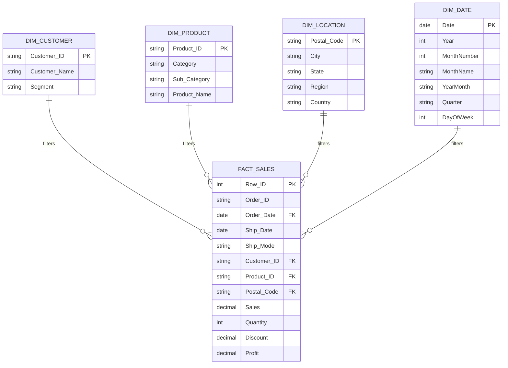

# Power BI Star Schema Data Model: Sales Performance

The Sales Performance dashboard is engineered around an industry-standard **Star Schema** to ensure high query performance, clean filter propagation, and intuitive DAX authoring.

---

## Relationship Specifications
1. **`Dim_Customer[Customer_ID]` $\xrightarrow{1:M}$ `Fact_Sales[Customer_ID]`**
   - Cardinality: One-to-Many ($1:*$)
   - Cross-filter direction: Single (Dimension filters Fact)
2. **`Dim_Product[Product_ID]` $\xrightarrow{1:M}$ `Fact_Sales[Product_ID]`**
   - Cardinality: One-to-Many ($1:*$)
   - Cross-filter direction: Single
3. **`Dim_Location[Postal_Code]` $\xrightarrow{1:M}$ `Fact_Sales[Postal_Code]`**
   - Cardinality: One-to-Many ($1:*$)
   - Cross-filter direction: Single
4. **`Dim_Date[Date]` $\xrightarrow{1:M}$ `Fact_Sales[Order_Date]`**
   - Cardinality: One-to-Many ($1:*$)
   - Cross-filter direction: Single (Marked as Official Date Table in Power BI)
